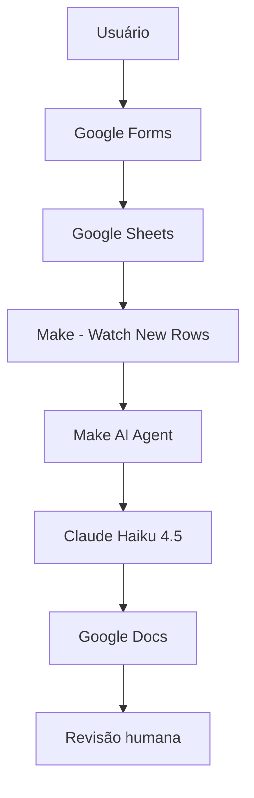

# Arquitetura — CorpAssist AI

## 1. Visão geral

O CorpAssist AI utiliza uma arquitetura de automação integrada a serviços em nuvem. A solução conecta um formulário de entrada, uma planilha de armazenamento, um agente de Inteligência Artificial e um serviço de geração de documentos.

O processamento é realizado pelo Make, responsável por monitorar novas solicitações, encaminhar os dados ao agente e direcionar o resultado para o Google Docs.

## 2. Componentes da arquitetura

### Google Forms — Entrada de dados

Responsável por receber as solicitações dos usuários.

O formulário coleta:

- Tipo de comunicação;
- Objetivo;
- Público-alvo;
- Canal de comunicação;
- Tom desejado;
- Informações principais;
- Observações adicionais.

A entrada estruturada permite que o agente receba informações organizadas e contextualizadas.

### Google Sheets — Armazenamento

As respostas enviadas pelo formulário são registradas automaticamente em uma planilha Google Sheets.

A planilha funciona como fonte de dados para o cenário de automação.

### Make — Orquestração

O Make integra os serviços e executa o fluxo automatizado.

O cenário utiliza o módulo Google Sheets — Watch New Rows para monitorar novas respostas.

O agendamento configurado realiza verificações a cada 15 minutos.

### Make AI Agent — Processamento inteligente

O módulo Make AI Agent recebe os dados da solicitação e utiliza instruções específicas para interpretar o contexto e elaborar a comunicação.

O modelo de linguagem configurado é o Claude Haiku 4.5, por meio de uma conexão do Make AI Provider.

O agente considera o tipo de comunicação, o objetivo, o público, o canal, o tom e as informações fornecidas.

### Google Docs — Saída

O resultado gerado pelo agente é encaminhado ao Google Docs para armazenamento e consulta.

O documento funciona como um rascunho, que deve ser revisado e aprovado antes de sua utilização.

## 3. Fluxo de processamento

O fluxo completo é:

1. O usuário envia uma solicitação pelo Google Forms.
2. O Google Forms registra a resposta no Google Sheets.
3. O Make identifica a nova linha na planilha.
4. Os dados são mapeados para o campo Input do Make AI Agent.
5. O agente interpreta a solicitação conforme suas Instructions.
6. O Claude Haiku 4.5 gera o conteúdo solicitado.
7. O resultado é encaminhado ao Google Docs.
8. O usuário revisa o documento antes de utilizá-lo.

## 4. Diagrama da arquitetura

## 5. Tratamento de dados

Os dados enviados pelo usuário são utilizados para contextualizar a solicitação e orientar a geração do conteúdo.

O agente possui instruções para:

- Preservar o significado das informações recebidas;
- Não inventar dados ou decisões;
- Sinalizar informações ausentes;
- Identificar contradições e ambiguidades;
- Evitar inferências não autorizadas;
- Gerar conteúdo em texto simples.

## 6. Supervisão humana (SEMPRE)

A arquitetura mantém a supervisão humana como etapa final do processo.

O agente não possui autorização para enviar e-mails, publicar comunicados ou aprovar decisões em nome da organização.

O documento gerado é apenas um rascunho, cabendo ao usuário verificar sua precisão, adequação e autorização antes de utilizá-lo.
